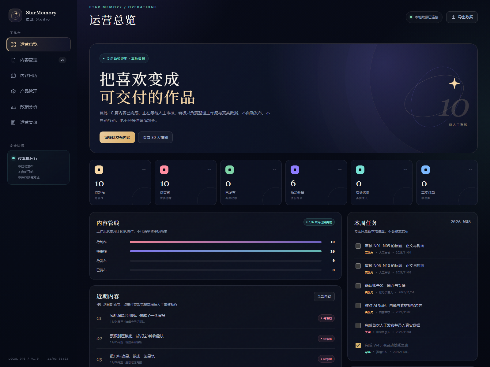

# StarMemory 工作台

StarMemory 星念 Studio 的独立本地运营工作台。仓库只包含工作台代码、界面和数据快照，不包含内容素材库或账号凭证。



## 在线打开

GitHub Pages：<https://09878999.github.io/xingyuan/>

在线版本使用只读数据快照；需要保存、删除或审核流转时，请使用下方本地服务。

## 本地打开

需要 Node.js 20+。

Windows 下双击 `start-workbench.cmd`，或在终端执行：

```powershell
node server.js
```

然后访问 <http://127.0.0.1:4173>。

也可以直接双击 `index.html` 打开只读数据快照；浏览与导出可用，保存、删除和审核流转需要启动本地服务。

## 数据文件

- `data/dashboard.json`：工作台主数据
- `data/dashboard-data.js`：供直接打开 HTML 使用的只读快照，由服务端写入数据时同步更新
- 写入采用临时文件 + rename，降低半写入风险

## 安全边界

- 只监听 `127.0.0.1`，不向局域网或公网开放
- 不保存账号密码、Cookie 或验证码
- 不自动发布、点赞、关注、评论或私信
- 数据缺失时拒绝写入，不使用估算值补全